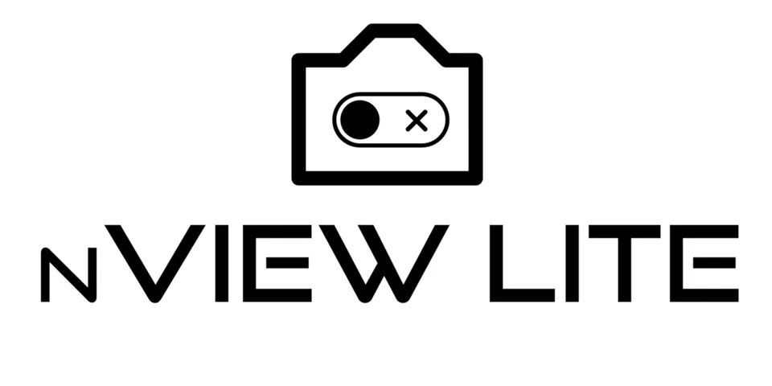
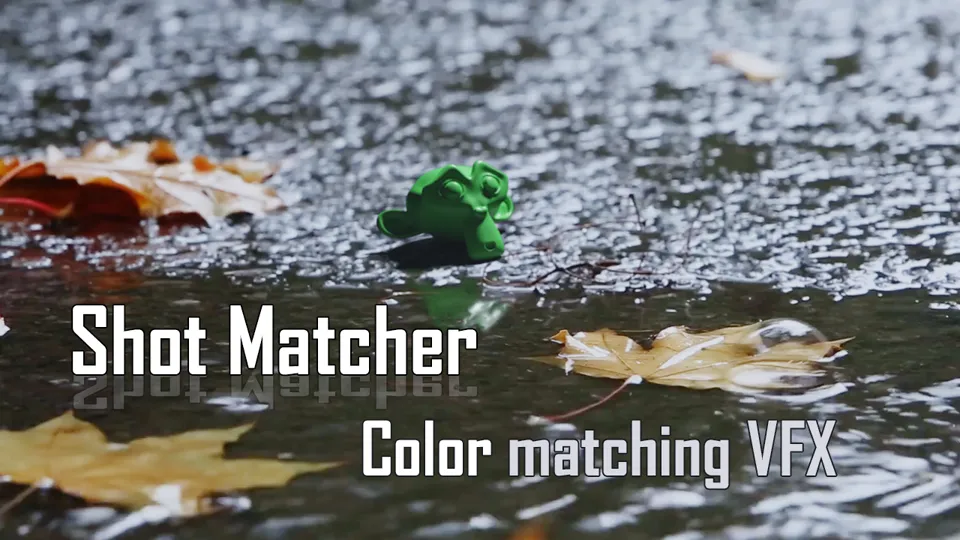

## My Official Extensions Repository

Welcome!
Here you can add my repository in Blender 4.2 to access all my free extensions.

Just add the following URL in Blender as a remote repository:

> [https://extensions.spencermagnusson.com/add_ons/index.json](https://extensions.spencermagnusson.com/add_ons/index.json)

If you need them offline, you can download them individually,
either from their own repositories or the zip files included in this repository.

## Includes

[nView Lite](https://projects.blender.org/SMagnusson/nview_lite),
a demo version of [nView](https://blendermarket.com/products/nview-v3/)
to simplify camera-based scene optimization.

[Shot Matcher](https://codeberg.org/semagnum/shot_matcher)
to simplify basic color matching for compositing visual effects

[BLint](https://codeberg.org/semagnum/blint) for simplified project standardization and quality checks

[Color From Material](https://codeberg.org/semagnum/ColorFromMaterial)
to quickly generate viewport materials colors based on the shader nodes

### Others I'm too lazy to make a thumbnail for

- [Copy Render Command](https://projects.blender.org/SMagnusson/copy_render_command)
  generates a command to render your current file,
  and copies it to your clipboard.
  Paste it into your favorite terminal, and enjoy command line rendering!
- [Separate with Instances](https://codeberg.org/semagnum/separate_with_instances)
  extends the mesh separate operator to add separated pieces to other mesh instances.
- [Native Cycles Denoise](https://codeberg.org/semagnum/native_cycles_denoise)
  exposes Cycles's native temporal denoising to the render menu.
- [Save with Prefix](https://projects.blender.org/SMagnusson/save_with_prefix) reminds users to save files with a user-defined prefix. Can use date format or text. Once the user saves, a confirmation dialog is displayed asking if they want to save the file with the prefix. If the user confirms, the file is saved again with the prefix (.blend1 files are also renamed with the prefix).
- [Save Your Autosave](https://codeberg.org/semagnum/save_your_autosave) makes it easier to monitor autosaves by displaying the last time it autosaved and exposes currently running modal operators.
- [Scene Complexity](https://codeberg.org/semagnum/scenecomplexity)
to analyze the complexity of your scene and make better optimization decisions